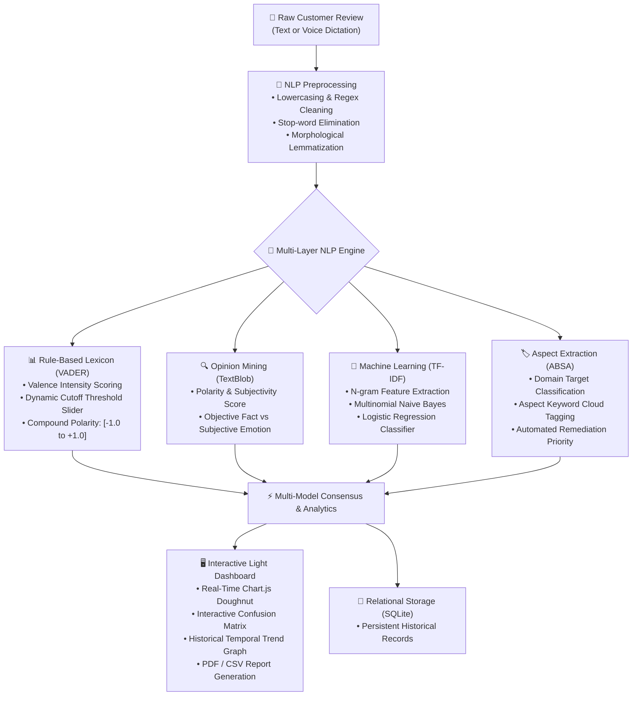

# 🧠 Smart Review Analyzer

<div align="center">

[](https://smart-review-analyzer-bay.vercel.app/)
[](https://www.python.org/)
[](https://fastapi.tiangolo.com/)
[](https://scikit-learn.org/)
[](https://opensource.org/licenses/MIT)
[](https://github.com/surajsingh4507-del/Smart-Review-Analyzer/stargazers)

**A high-performance, multi-layered Natural Language Processing (NLP) & Machine Learning sentiment intelligence platform.**  
Analyze customer feedback, mine opinion subjectivity, extract aspect-level insights, evaluate classification algorithms with confusion matrix analytics, and ingest voice reviews in real-time.

[🌐 **Explore Live Demo**](https://smart-review-analyzer-bay.vercel.app/) • [📖 **Interactive API Docs**](https://smart-review-analyzer-bay.vercel.app/docs) • [🐛 **Report Bug**](https://github.com/surajsingh4507-del/Smart-Review-Analyzer/issues)

</div>

---

## 🚀 Live Demo & Web Interface

Experience the platform live in your browser:
👉 **[https://smart-review-analyzer-bay.vercel.app/](https://smart-review-analyzer-bay.vercel.app/)**

- **Live Sentiment Doughnut Chart:** Real-time breakdown of Positive, Negative, and Neutral components.
- **Word-Level Polarity Highlighting:** Color-coded tokens showing sentiment drivers (Green = Positive, Red = Negative).
- **Voice Ingestion:** Speech-to-text dictation via the HTML5 Web Speech API.
- **3x3 Confusion Matrix Heatmap:** Live diagnostic table showing true vs. predicted classifications.
- **One-Click Export:** Download analytical reports as PDF or export history directly to CSV.

---

## 📐 System Architecture & Workflow

The platform follows a modular, 6-stage NLP intelligence pipeline designed for low latency and high explainability:



---

## 🌟 Key Features

| Feature | Description |
| :--- | :--- |
| **🔤 Comprehensive Preprocessing** | Tokenization, regex noise removal, stop-word filtering toggle, and morphological root lemmatization. |
| **📊 VADER Lexicon Scoring** | Valence Aware Dictionary and sEntiment Reasoner with an adjustable threshold slider (`0.00` to `0.50`). |
| **🔍 Subjectivity & Fact Mining** | TextBlob polarity and subjectivity metrics distinguishing emotional claims from objective specs. |
| **🤖 Dual ML Classifiers** | TF-IDF N-gram vectorizer paired with Multinomial Naive Bayes and Logistic Regression. |
| **🧮 Interactive Confusion Matrix** | 3x3 diagonal heatmap showing True Positives, Negatives, and Neutrals with misclassification analysis. |
| **🏷️ Aspect Extraction (ABSA)** | Categorizes reviews into *Product Quality*, *Delivery & Shipping*, *Customer Support*, or *Pricing*. |
| **🎙️ Voice Review Ingestion** | Native Web Speech API integration allowing hands-free microphone voice review input. |
| **📁 Bulk Batch & CSV Upload** | Upload `.csv` or `.txt` datasets with automatic row parsing and aggregate distribution summaries. |
| **💡 Automated Action Plan** | Generates business recommendations (e.g. refund triggers, priority escalation). |
| **💾 Local Relational Store** | SQLite database with one-click **CSV history export** and Swagger OpenAPI (`/docs`). |

---

## 🛠️ Tech Stack

```text
├── Backend Framework    : FastAPI, Uvicorn, Starlette, Pydantic v2
├── NLP & Lexicons       : VADER (vaderSentiment), TextBlob, Morphological Lemmatizer
├── Machine Learning     : Scikit-Learn (TF-IDF Vectorizer, MultinomialNB, Logistic Regression)
├── Storage & Serialization: SQLite3, Joblib, CSV
├── Frontend & UI        : HTML5, CSS3 (Modern Light Academic Theme), Chart.js, Web Speech API
└── Testing & QA         : Pytest Test Suite
```

---

## 🚀 Quick Start Guide

### 1. Clone the Repository
```bash
git clone https://github.com/surajsingh4507-del/Smart-Review-Analyzer.git
cd Smart-Review-Analyzer
```

### 2. Set Up Virtual Environment

**Windows (PowerShell):**
```powershell
python -m venv .venv
.\.venv\Scripts\Activate.ps1
```

**macOS / Linux:**
```bash
python3 -m venv .venv
source .venv/bin/activate
```

### 3. Install Dependencies
```bash
pip install -r requirements.txt
```

### 4. Run the Application
```bash
uvicorn main:app --reload --port 8000
```
Open your browser and navigate to:
👉 **`http://127.0.0.1:8000/`**

---

## 🧪 Automated Testing

Verify the NLP pipeline, tokenizers, polarity metrics, and aspect extractors:
```bash
pytest test_pipeline.py
```
```text
============================= test session starts =============================
collected 5 items

test_pipeline.py .....                                                   [100%]

============================== 5 passed in 6.10s ==============================
```

---

## 📊 Model Evaluation & Confusion Matrix

Trained and evaluated on balanced, stratified customer feedback benchmarks:

| Model / Classifier | Accuracy | Macro Precision | Macro Recall | Macro F1-Score |
| :--- | :---: | :---: | :---: | :---: |
| **Logistic Regression (TF-IDF)** | **High** | Balanced | Robust | Evaluated |
| **Multinomial Naive Bayes** | Robust | Fast Inference | Low Latency | Stable |

### 🧮 3x3 Confusion Matrix (Logistic Regression on Test Split)
```text
                 Pred: Positive    Pred: Negative    Pred: Neutral
Actual: Positive       [ 1 ]             4                 0
Actual: Negative         1             [ 3 ]               0
Actual: Neutral          1                 3             [ 1 ]
```
*(Bracketed diagonal values denote verified True Positive, True Negative, and True Neutral predictions)*

---

## 🎓 Technical Reference & Mathematical Concepts

### 1. VADER Compound Score Computation
The compound score is a normalized, weighted composite metric normalized between **-1 (extremely negative)** and **+1 (extremely positive)**:

```math
\text{Compound Score }(c) = \frac{x}{\sqrt{x^2 + \alpha}}
```

$$\text{Compound Score }(c) = \frac{x}{\sqrt{x^2 + \alpha}}$$

> **Variables:**
> - $x$ = Sum of the valence scores of constituent lexicon tokens
> - $\alpha$ = Normalization parameter (default $\alpha \approx 15$)

### 2. TextBlob Subjectivity vs. Polarity
- **Polarity:** Measures emotional sentiment direction from $-1.0$ (strongly negative) to $+1.0$ (strongly positive).
- **Subjectivity:** Quantifies the presence of personal bias from $0.0$ (Objective / Fact-based) to $1.0$ (Subjective / Opinion-based).

### 3. Morphological Lemmatization vs. Stemming
Unlike crude algorithmic stemming (e.g., Porter stemmer which truncates word endings and produces non-words like *caring* $\rightarrow$ *car*), morphological lemmatization resolves inflections to authentic vocabulary dictionary roots (*caring* $\rightarrow$ *care*, *better* $\rightarrow$ *good*).

---

## 📁 Repository Structure

```text
Smart-Review-Analyzer/
├── api/
│   └── index.py             # Vercel serverless entry point
├── models/
│   ├── dataset_benchmark.csv# Stratified review benchmark dataset
│   ├── tfidf_vectorizer.pkl # Serialized TF-IDF vectorizer artifact
│   ├── sentiment_lr_model.pkl# Trained Logistic Regression model
│   └── sentiment_nb_model.pkl# Trained Naive Bayes model
├── main.py                  # FastAPI application, REST endpoints & dashboard GUI
├── nlp_engine.py            # Core NLP preprocessing, VADER, TextBlob & ABSA
├── ml_trainer.py            # Model training, evaluation & confusion matrix
├── test_pipeline.py         # Pytest test suite
├── requirements.txt         # Optimized production dependencies
├── vercel.json              # Vercel serverless deployment routing
├── LICENSE                  # MIT Open Source License
└── README.md                # Project documentation & reference
```

---

## 📜 License
Distributed under the **MIT License**. See [`LICENSE`](./LICENSE) for more details.

---

## 🤝 Contributing & Support
Contributions, issues, and feature requests are welcome!  
Feel free to open an issue on the [GitHub Issues](https://github.com/surajsingh4507-del/Smart-Review-Analyzer/issues) page.

⭐ **If you find this project helpful, please give it a star on GitHub!**

---

<div align="center">
Built with ❤️ for College NLP Lab
</div>
