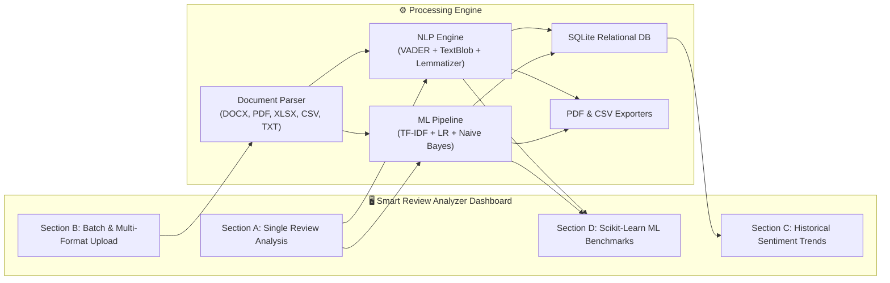
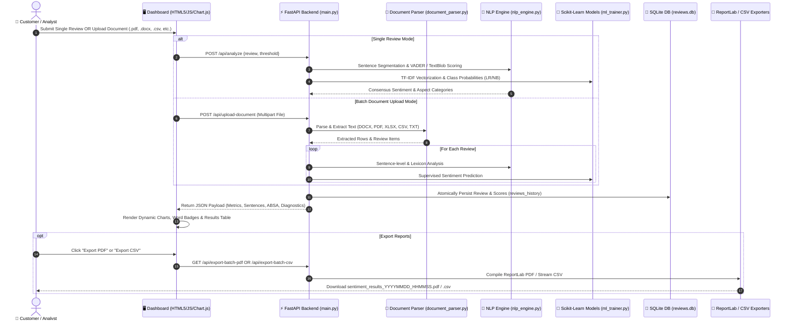

# 🧠 Smart Review Analyzer v3.0
### *AI-Powered Sentiment Intelligence, Multi-Format Document Processing & Aspect Analytics*

<div align="center">

[](https://www.python.org/)
[](https://fastapi.tiangolo.com/)
[](https://scikit-learn.org/)
[](https://github.com/cjhutto/vaderSentiment)
[](https://www.sqlite.org/)
[](https://www.reportlab.com/)
[-059669?style=for-the-badge&logo=pytest&logoColor=white)](https://pytest.org/)
[](LICENSE)

<br/>

**Smart Review Analyzer v3.0** is an enterprise-grade Natural Language Processing (NLP) and Machine Learning platform that transforms unstructured customer feedback into real-time, actionable business intelligence. It integrates lexicon-based sentiment analysis, subjective opinion mining, supervised machine learning, multi-format document parsing, sentence-level distribution tracking, and paginated executive report generation.

</div>

---

## 📑 Table of Contents
1. [Executive Summary & Problem Statement](#-executive-summary--problem-statement)
2. [Full Feature Walkthrough (Site Capabilities)](#-full-feature-walkthrough-site-capabilities)
   - [Section A: Single Review Analysis & Sentence Analytics](#1-section-a-single-review-analysis)
   - [Section B: Batch & Multi-Format Document Ingestion](#2-section-b-batch--multi-format-document-ingestion)
   - [Section C: Aspect-Based Sentiment & Priority Triage](#3-section-c-aspect-based-sentiment-analysis-absa)
   - [Section D: Historical Sentiment Trends & SQLite Persistence](#4-section-d-historical-sentiment-trends--analytics)
   - [Section E: Machine Learning Benchmarks & 3x3 Confusion Matrix](#5-section-e-machine-learning-benchmarks--confusion-matrix)
   - [Section F: Professional PDF & CSV Export Engine](#6-section-f-professional-pdf--csv-export-engine)
3. [System Architecture & Dataflow](#-system-architecture--dataflow)
4. [Supported Document Formats & Parser Specifications](#-supported-document-formats--parser-specifications)
5. [NLP & Machine Learning Pipeline](#-nlp--machine-learning-pipeline)
6. [Technology Stack](#-technology-stack)
7. [RESTful API Reference](#-restful-api-reference)
8. [Installation & Local Setup](#-installation--local-setup)
9. [Automated Verification & Test Suite (54 Tests)](#-automated-verification--test-suite)
10. [🎯 PowerPoint (PPT) Presentation Deck Guide (Slide-by-Slide)](#-powerpoint-ppt-presentation-deck-guide)

---

## 📌 Executive Summary & Problem Statement

### The Problem
Customer reviews on e-commerce platforms, service portals, and feedback forms are unstructured, high-volume, and linguistically complex. Businesses struggle with:
- **Mixed Sentiments:** Reviews containing both high praise and critical flaws (e.g., *"Beautiful display and great battery, but the camera overheats"*).
- **Format Fragmentation:** Customer feedback scattered across Word documents (`.docx`, `.doc`), spreadsheets (`.csv`, `.xlsx`, `.xls`), PDFs (`.pdf`), and text files (`.txt`).
- **Surface-Level Metrics:** Naive sentiment tools classify entire paragraphs into a single binary label, missing subtle sentence-level nuances and critical domain complaints.
- **Lack of Actionable Triage:** Customer service teams cannot quickly differentiate urgent hardware defects or shipping failures from minor complaints.

### The Solution: Smart Review Analyzer v3.0
Smart Review Analyzer solves these challenges through a unified multi-tiered pipeline:
1. **Sentence-Level Decomposition:** Breaks long reviews into individual sentences and tracks Positive, Negative, and Neutral proportions with mathematical compound aggregation.
2. **Multi-Model Consensus:** Combines rule-based VADER lexicons, TextBlob subjectivity quantification, and supervised Scikit-Learn models (Logistic Regression + Multinomial Naive Bayes) with genuine class probabilities.
3. **Multi-Format Document Engine:** Ingests 7 document formats up to 15 MB with automatic delimiter sniffing, weighted review column detection, metadata penalties, and OCR alerts for scanned PDFs.
4. **Aspect & Priority Extraction:** Identifies domain aspects (*Product Quality*, *Delivery & Shipping*, *Customer Support*, *Pricing*) and assigns triage priority levels (*High*, *Medium*, *Low*).
5. **Persistent History & Reporting:** Automatically records interactions in an embedded SQLite database, visualizes sentiment progression over time with Chart.js, and generates downloadable CSV and paginated executive PDF reports.

---

## 🚀 Full Feature Walkthrough (Site Capabilities)



---

### 1. Section A: Single Review Analysis

Dedicated exclusively to in-depth, text-based customer review sentiment evaluation.

- **Interactive Text Input & Samples:** User-friendly textarea with instant sample loaders (e.g., *"Samsung Galaxy A55 In-depth Review"*, *"Mixed Quality Review"*, *"Severe Delivery Complaint"*, *"Negation Case"*).
- **Voice Dictation (Speech-to-Text):** Integrated HTML5 Web Speech API allowing users to dictate reviews hands-free via their microphone with visual pulsing indicators.
- **Dynamic VADER Threshold Slider:** Real-time adjustable compound cutoff threshold (`0.00` to `0.50`, default `±0.05`), allowing users to tune sensitivity between Neutral, Positive, and Negative.
- **Stopwords Filter Toggle:** Visual toggle allowing users to highlight or dim filtered English stopwords while strictly preserving sentiment-critical negations (*not, never, barely, neither*).
- **Sentence-Level Distribution Analytics:**
  - Tokenizes paragraphs into discrete sentences using abbreviation- and decimal-protected segmentation.
  - Classifies every sentence independently as Positive, Negative, or Neutral.
  - Displays a visual **Sentence Distribution Doughnut Chart** and metric breakdown cards (counts & exact percentages).
  - Calculates the final sentiment from the mean compound score across sentences rather than crude majority voting.
- **Multi-Model Consensus Card:**
  - **VADER:** Positive, Negative, Neutral, and Compound scores (`-1.0` to `+1.0`).
  - **TextBlob:** Polarity (`-1.0` to `+1.0`) and Subjectivity (`0.0: Pure Fact` to `1.0: Pure Opinion`).
  - **Logistic Regression & Naive Bayes:** Predicted sentiment with genuine predicted class probabilities from calibrated `predict_proba()`.
- **Word-Level Sentiment Highlighter:** Interactive badge tokens displaying contextual sentiment drivers (Green = Positive valence, Red = Negative valence, Slate = Neutral).
- **Explainable AI (XAI) Sentiment Summary:** Plain-English summary explaining *why* the review was classified as Positive, Negative, or Neutral based on valence intensities and sentence distributions.

---

### 2. Section B: Batch & Multi-Format Document Ingestion

Processes high-volume customer feedback through document uploads or bulk text pasting.

- **Dual Ingestion Workflows:**
  - **Option 1: Multi-Format File Upload:** Drag-and-drop or file selector supporting `.docx`, `.doc`, `.pdf`, `.csv`, `.xlsx`, `.xls`, and `.txt` up to 15 MB.
  - **Option 2: Pasted Bulk Reviews:** Direct textarea input supporting numbered lists (`1. ...`), multiline reviews, or newline-delimited reviews.
- **Intelligent Review Segmentation Modes:**
  - `Auto`: Automatically detects document structure (tables, numbered lists, or narrative blocks).
  - `Single Review`: Treats the entire uploaded document as one single continuous review.
  - `Multiple Reviews`: Splits tabular rows, lines, or blocks into individual reviews.
  - `Paragraph Mode`: Forces every distinct paragraph to be evaluated as a separate customer review.
- **Smart Column Detection & Override:**
  - Auto-identifies review narrative columns using semantic keywords (`review_text`, `comment`, `feedback`, `content`, `description`).
  - Applies a `-200.0` penalty to metadata/ID columns (`review_id`, `id`, `rating`, `date`, `author`) to prevent ID misclassification.
  - Allows manual column specification with case-insensitive and fuzzy matching.
- **Comprehensive Processing Diagnostics:**
  - Displays extracted file name, detected format, file size, character count, word count, candidate columns discovered, review column used, and processed vs. failed counts.
  - Alerts users if scanned PDFs without extractable text are uploaded.
- **Interactive Batch Analytics Dashboard:**
  - **Aggregate KPI Scorecards:** Total reviews processed, success rate, failed records count, and processing duration.
  - **Visual Chart.js Doughnut Chart:** Batch sentiment breakdown (Positive %, Negative %, Neutral %).
  - **Visual Chart.js Bar Chart:** Review volume categorized by aspect category (*Product Quality*, *Shipping*, *Customer Support*, *Pricing*).
  - **Interactive Results Table:** Filterable, searchable table displaying Source ID, Review Snippet, Sentiment Badge, Confidence Score, VADER Compound, Aspect Tags, and Priority Level.

---

### 3. Section C: Aspect-Based Sentiment Analysis (ABSA) & Triage

Extracts granular business entities and prioritizes negative feedback for operational triage.

- **Automated Aspect Extraction:** Scans review text for domain entities across 4 key operational categories:
  - 📦 **Product Quality:** Hardware, display, battery, design, materials, durability, performance, bugs, build.
  - 🚚 **Delivery & Shipping:** Courier, transit time, delay, package condition, damage, tracking, dispatch.
  - 🎧 **Customer Support:** Helpdesk, representative, refund, replacement, warranty, responsiveness, service.
  - 💰 **Pricing & Value:** Cost, expensive, discount, value for money, subscription, price tag, worth.
- **Operational Priority Assignment:**
  - 🔴 **High Priority:** Urgent complaints, hardware defects (*overheating, broken, defective, cracked, unresponsive*), or severe delivery failures requiring immediate customer intervention.
  - 🟡 **Medium Priority:** Moderate dissatisfaction, average charging speeds, minor design feedback, or minor pricing concerns.
  - 🟢 **Low Priority:** Satisfied customers, neutral factual inquiries, or general positive feedback.
- **Actionable Business Recommendations:** Generates automated operational next steps (e.g., *"Route to Quality Assurance for battery inspection"*, *"Forward to logistics partner to investigate dispatch delays"*).

---

### 4. Section D: Historical Sentiment Trends & Analytics

Maintains an embedded historical audit trail of all analyses with real-time visualization.

- **Persistent Relational SQLite Database:** Stores all interactions across single reviews, pasted batches, and document uploads in `reviews.db`.
- **Dynamic Database Path Resolution:** Reliably resolves absolute paths, supports the `SQLITE_DB_PATH` environment variable, and uses `/tmp/reviews.db` in serverless deployments.
- **Idempotent Schema Migration:** Automatically migrates schemas to include `vader_pos`, `vader_neg`, `vader_neu`, and `source` while preserving 100% of existing historical records.
- **Accidental Duplicate Suppression:** Automatically ignores immediate identical re-submissions to maintain database hygiene.
- **Real-Time Historical Summary Pills:** Live counts showing total Positive, Negative, Neutral, and Total stored records.
- **Chart.js Historical Trend Line Chart:** Interactive line chart tracking VADER compound scores over recent analyses with color-coded sentiment nodes (Green = Positive, Red = Negative, Slate = Neutral).
- **Recent Analyses Table:** Tabular view of historical records with review snippets, confidence percentages, compound scores, priority tags, and formatted timestamps.
- **Full Review Modal Viewer:** Clickable "View Full" button opening a clean popup modal with complete un-truncated review text, full score metrics, and analysis source.
- **Active Refresh Button:** Refresh history on demand with dynamic loading spinners without reloading the web page.

---

### 5. Section E: Machine Learning Benchmarks & Confusion Matrix

Live evaluation of supervised machine learning models trained on stratified customer reviews.

- **Dual Classifiers:**
  - **Multinomial Logistic Regression:** High-precision linear model with balanced regularization.
  - **Multinomial Naive Bayes (MNB):** Ultra-fast probabilistic classifier with Laplace smoothing.
- **N-Gram Feature Engineering:** TF-IDF vectorizer using unigrams and bigrams `(1, 2)` with negation-preserving sub-linear term frequency scaling.
- **Comparative Performance Metrics:** Displays Test Accuracy, Macro Precision, Macro Recall, and Macro F1-score with sub-millisecond inference latency benchmarks.
- **Interactive 3x3 Confusion Matrix Heatmap:** Live multi-class matrix displaying True Positive, True Negative, and True Neutral predictions vs. actual ground truth with highlighted diagonal consensus cells.

---

### 6. Section F: Professional PDF & CSV Export Engine

Enables one-click sharing, reporting, and archival of sentiment analytics.

- **Instant Batch CSV Export:** Generates standardized CSV datasets (`sentiment_results_YYYYMMDD_HHMMSS.csv`) containing Review ID, Original Review, Sentiment, ML Confidence, VADER Compound, TextBlob Polarity, Aspect Categories, and Priority.
- **Historical CSV Export:** Downloads historical interaction records (`historical_sentiment_YYYYMMDD_HHMMSS.csv`) with automatic 404 alert handling if the database is empty.
- **Paginated Executive PDF Report Generation:**
  - Built with **ReportLab** producing publication-quality documents (`sentiment_results_YYYYMMDD_HHMMSS.pdf`).
  - **Custom Cover Header:** Professional corporate styling with title, metadata, generated timestamp, and branding.
  - **Executive KPI Scorecard:** Visual cards summarizing Total Reviews, Positive %, Negative %, and Neutral %.
  - **Distribution Summary Table:** Formatted tabular breakdown with color-coded headers.
  - **Detailed Review Ledger:** Paginated table listing every customer review, predicted sentiment, confidence percentage, extracted aspect categories, and priority level.
  - **Automated Page Numbering & Footers:** Dynamic page numbering (*"Page X of Y"*) and confidentiality notices.

---

## 📐 System Architecture & Dataflow



---

## 📁 Supported Document Formats & Parser Specifications

The document parsing subsystem ([`document_parser.py`](document_parser.py)) provides resilient, multi-format text extraction:

| File Format | Extension | Underlying Engine | Key Capabilities & Error Handling |
| :--- | :--- | :--- | :--- |
| **Microsoft Word (Modern)** | `.docx` | `python-docx` | Extracts body paragraphs, bullet points, headers, and structured table cell content. |
| **Legacy Word** | `.doc` | Binary / Olefile / LibreOffice | Safe binary string parsing with LibreOffice headless conversion fallback. |
| **Portable Document Format** | `.pdf` | `pypdf` | Multi-page text extraction. Emits a descriptive OCR alert if scanned/empty PDFs are detected. |
| **Comma-Separated Values** | `.csv` | Python `csv` + Sniffer | Auto-detects delimiters (`,`, `;`, `\t`, `\|`), header detection, and weighted column selection. |
| **Excel Spreadsheet (Modern)** | `.xlsx` | `openpyxl` | Multi-sheet scanning, header recognition, cell value normalization, and empty row skipping. |
| **Legacy Excel Spreadsheet** | `.xls` | `xlrd` | Legacy BIFF8 format parsing with automatic numeric formatting and sheet traversal. |
| **Plain Text Files** | `.txt` | Multi-encoding `io` | UTF-8, UTF-16, Latin-1, and CP1252 multi-encoding fallback with paragraph segmentation. |

---

## 🔬 NLP & Machine Learning Pipeline

### 1. Text Preprocessing & Cleaning
- **Lowercasing & Noise Removal:** Strips HTML tags, excess whitespace, and non-essential punctuation while retaining sentence-terminating markers (`.`, `!`, `?`).
- **Negation Word Preservation:** Identifies and isolates 32 English negation words (*not, never, neither, nor, barely, hardly, won't, couldn't, isn't*) so that sentiment-inversion context is never lost.
- **Stopwords Filter with Toggle:** Standard English stopwords are filtered for vectorization but preserved during contextual lexicon scoring.
- **Morphological Lemmatization:** Replaces algorithmic word truncation with WordNet morphological dictionary lemmatization (*"better"* $\rightarrow$ *"good"*, *"overheating"* $\rightarrow$ *"overheat"*).

### 2. Lexicon-Based Sentiment (VADER)
Calculates valence scores using an augmented dictionary calibrated for consumer reviews:
$$\text{Compound Score }(c) = \frac{\sum v_i}{\sqrt{\left(\sum v_i\right)^2 + \alpha}}$$
Where $\alpha = 15$ bounds compound polarity smoothly between $[-1.0, +1.0]$.
- **Positive:** $c > +\text{threshold}$ (Default: $> +0.05$)
- **Negative:** $c < -\text{threshold}$ (Default: $< -0.05$)
- **Neutral:** $-\text{threshold} \le c \le +\text{threshold}$

### 3. Subjectivity & Opinion Mining (TextBlob)
- **Polarity:** Measures directional emotional orientation from **-1.0** (negative) to **+1.0** (positive).
- **Subjectivity:** Quantifies factual vs. opinionated language from **0.0** (Completely Objective Fact) to **1.0** (Completely Subjective Opinion).

### 4. Supervised Machine Learning Models
- **Feature Vectorizer:** Scikit-Learn TF-IDF vectorizer using unigrams and bigrams `(1, 2)` with sub-linear term frequency weighting.
- **Multinomial Logistic Regression:** Calibrated linear classifier outputting genuine class probability distributions via `predict_proba()`.
- **Multinomial Naive Bayes:** Probabilistic baseline model utilizing feature log-likelihoods with additive Laplace smoothing ($\alpha = 1.0$).

---

## 🛠️ Technology Stack

| Domain | Technology / Library | Version | Purpose in Application |
| :--- | :--- | :--- | :--- |
| **Backend Framework** | **FastAPI** | `0.115.6+` | High-performance asynchronous REST API architecture |
| **ASGI Web Server** | **Uvicorn** | `0.34.0+` | Production ASGI web server for hosting FastAPI |
| **Validation & Schema** | **Pydantic** | `2.10.4+` | Strongly-typed request/response validation |
| **Machine Learning** | **Scikit-Learn** | `1.6.0+` | TF-IDF vectorization, Logistic Regression, Naive Bayes |
| **Lexicon NLP** | **vaderSentiment** | `3.3.2+` | Rule-based valence intensity and compound scoring |
| **Linguistic NLP** | **TextBlob** | `0.18.0+` | Polarity orientation and subjectivity quantification |
| **NLP Tokenizer** | **NLTK** | `3.9.1+` | Sentence segmentation and token processing |
| **Database Engine** | **SQLite3** | Built-in | Embedded relational storage for audit history |
| **Model Persistence** | **Joblib** | `1.4.2+` | Serialized model loading (`.pkl` vectorizer & models) |
| **Word Processing** | **python-docx** | `1.1.2+` | Microsoft Word (.docx) document extraction |
| **PDF Extraction** | **pypdf** | `5.1.0+` | Multi-page text extraction from PDF files |
| **Excel Modern** | **openpyxl** | `3.1.5+` | Workbook and cell parsing from .xlsx spreadsheets |
| **Excel Legacy** | **xlrd** | `2.0.1+` | Legacy .xls spreadsheet ingestion |
| **PDF Generation** | **ReportLab** | `4.2.5+` | Paginated executive PDF report compilation |
| **Frontend UI** | **HTML5 / CSS3 / JS** | Native | Responsive light-theme dashboard GUI |
| **Data Visualizations** | **Chart.js** | `4.4.0` (CDN) | Doughnut, Bar, and Line charts |
| **Voice Dictation** | **Web Speech API** | Browser Native | Real-time speech-to-text dictation |
| **Testing Harness** | **Pytest** | `9.2.0+` | Automated regression test execution |

---

## 🌐 RESTful API Reference

| Method | Endpoint | Description | Request Payload / Params | Response Format |
| :---: | :--- | :--- | :--- | :--- |
| `GET` | `/` | Serves the interactive Web Dashboard GUI | None | `text/html` |
| `GET` | `/health` | Application health check and subsystem status | None | `application/json` |
| `POST` | `/api/analyze` | Evaluates a single review (Sentence analytics, VADER, TextBlob, ML, ABSA) | `{"review": "string", "threshold": 0.05}` | `application/json` |
| `POST` | `/api/analyze-batch` | Analyzes multiple pasted reviews in bulk | `{"text": "string", "mode": "auto", "threshold": 0.05}` | `application/json` |
| `POST` | `/api/upload-document` | Ingests multi-format file (`.csv`, `.xlsx`, `.pdf`, `.docx`, `.txt`) | Multipart file form-data (`file`, `mode`, `column_name`) | `application/json` |
| `POST` | `/api/export-batch-csv` | Generates downloadable batch CSV report | Detailed batch JSON results | `text/csv` stream |
| `POST` | `/api/export-batch-pdf` | Generates paginated executive ReportLab PDF report | Detailed batch JSON results | `application/pdf` stream |
| `GET` | `/api/history` | Retrieves stored review history ordered newest-first | Query params: `?limit=15&offset=0` | `application/json` |
| `GET` | `/api/export-history-csv` | Streams all historical database records as a CSV | None | `text/csv` stream |
| `GET` | `/api/metrics` | Returns Scikit-Learn evaluation benchmarks & confusion matrix | None | `application/json` |
| `GET` | `/docs` | Auto-generated interactive Swagger UI | None | `text/html` |

---

## 💻 Installation & Local Setup

### 1. Clone the Repository
```bash
git clone https://github.com/surajsingh4507-del/Smart-Review-Analyzer.git
cd Smart-Review-Analyzer
```

### 2. Create and Activate Virtual Environment

**Windows (PowerShell):**
```powershell
python -m venv .venv
.\.venv\Scripts\Activate.ps1
```

**macOS / Linux:**
```bash
python3 -m venv .venv
source .venv/bin/activate
```

### 3. Install Dependencies
```bash
pip install -r requirements.txt
```

### 4. Start the Application
```bash
uvicorn main:app --reload --host 127.0.0.1 --port 8000
```

Open your browser and navigate to:
- 🖥️ **Interactive Web Application:** [`http://127.0.0.1:8000`](http://127.0.0.1:8000)
- 📖 **Interactive OpenAPI Documentation:** [`http://127.0.0.1:8000/docs`](http://127.0.0.1:8000/docs)

---

## 🧪 Automated Verification & Test Suite

The project includes an automated test suite ([`test_pipeline.py`](test_pipeline.py)) covering **54 distinct test cases** with an autouse isolated temporary SQLite database fixture:

```bash
pytest test_pipeline.py -v
```

```text
============================= test session starts =============================
platform win32 -- Python 3.14.0, pytest-9.2.0, pluggy-1.7.0
rootdir: E:\smart review analyzer
collected 54 items

test_pipeline.py::test_01_single_positive_sentiment PASSED               [  1%]
test_pipeline.py::test_02_single_negative_sentiment PASSED               [  3%]
test_pipeline.py::test_03_single_neutral_sentiment PASSED                [  5%]
test_pipeline.py::test_04_negations_handling PASSED                      [  7%]
test_pipeline.py::test_05_csv_multiple_reviews_column_detection PASSED   [  9%]
test_pipeline.py::test_06_txt_multiple_paragraphs PASSED                 [ 11%]
test_pipeline.py::test_07_docx_multiple_paragraphs PASSED                [ 13%]
test_pipeline.py::test_08_docx_table_extraction PASSED                   [ 15%]
test_pipeline.py::test_09_pdf_multi_page PASSED                          [ 17%]
test_pipeline.py::test_10_empty_scanned_pdf_error PASSED                 [ 19%]
test_pipeline.py::test_11_xlsx_multiple_reviews PASSED                   [ 21%]
test_pipeline.py::test_12_xlsx_column_detection PASSED                   [ 23%]
test_pipeline.py::test_13_corrupted_or_unsupported_formats PASSED       [ 25%]
test_pipeline.py::test_14_legacy_document_handling PASSED                [ 26%]
test_pipeline.py::test_15_long_document_and_size_limits PASSED           [ 28%]
test_pipeline.py::test_16_mixed_sentiment_in_single_review PASSED        [ 30%]
test_pipeline.py::test_17_batch_count_and_percentage_calculations PASSED [ 32%]
test_pipeline.py::test_18_failed_predictions_and_error_reporting PASSED  [ 34%]
test_pipeline.py::test_19_csv_export_content PASSED                     [ 36%]
test_pipeline.py::test_20_pdf_export_content PASSED                     [ 38%]
test_pipeline.py::test_21_frontend_dashboard_structure PASSED           [ 40%]
test_pipeline.py::test_22_single_review_api_regression PASSED           [ 42%]
test_pipeline.py::test_23_sentence_segmentation_decimals_abbreviations   PASSED [ 44%]
test_pipeline.py::test_24_samsung_galaxy_a55_sentence_level_analysis    PASSED [ 46%]
test_pipeline.py::test_25_sentence_distribution_and_zero_division        PASSED [ 48%]
test_pipeline.py::test_26_overall_sentiment_aggregation_not_majority     PASSED [ 50%]
test_pipeline.py::test_27_sentence_threshold_sensitivity                 PASSED [ 51%]
test_pipeline.py::test_28_single_review_api_sentence_integration        PASSED [ 53%]
test_pipeline.py::test_29_document_upload_single_paragraph_sentence      PASSED [ 55%]
test_pipeline.py::test_30_multi_review_sentence_distribution_separation PASSED [ 57%]
test_pipeline.py::test_31_sentence_negations_and_polar_cases             PASSED [ 59%]
test_pipeline.py::test_32_csv_header_detection_10_reviews_exact_count    PASSED [ 61%]
test_pipeline.py::test_33_csv_leading_empty_lines_and_whitespace_rows    PASSED [ 63%]
test_pipeline.py::test_34_confidence_metric_is_genuine_ml_probability    PASSED [ 65%]
test_pipeline.py::test_35_priority_labels_based_on_sentiment_severity    PASSED [ 67%]
test_pipeline.py::test_36_mixed_and_factual_sentiment_consistency        PASSED [ 69%]
test_pipeline.py::test_37_csv_multi_column_with_review_id_and_metadata   PASSED [ 71%]
test_pipeline.py::test_38_three_core_prompt_reviews_handling            PASSED [ 73%]
test_pipeline.py::test_39_csv_alternative_columns_and_manual_selection  PASSED [ 75%]
test_pipeline.py::test_40_csv_multiline_semicolons_and_numbered_items    PASSED [ 76%]
test_pipeline.py::test_41_diagnostics_when_empty_csv                     PASSED [ 78%]
test_pipeline.py::test_42_database_initialization_and_schema_migration   PASSED [ 80%]
test_pipeline.py::test_43_save_single_review_analysis_duplicate_check    PASSED [ 82%]
test_pipeline.py::test_44_retrieving_saved_history_newest_first          PASSED [ 84%]
test_pipeline.py::test_45_saving_batch_analysis_results_pasted_upload    PASSED [ 86%]
test_pipeline.py::test_46_database_path_resolution_and_env_override      PASSED [ 88%]
test_pipeline.py::test_47_empty_history_response_structure               PASSED [ 90%]
test_pipeline.py::test_48_table_rendering_frontend_elements_modal        PASSED [ 92%]
test_pipeline.py::test_49_historical_chart_configuration_resilience     PASSED [ 94%]
test_pipeline.py::test_50_refresh_history_functionality_pagination       PASSED [ 96%]
test_pipeline.py::test_51_historical_csv_export_content_and_headers      PASSED [ 98%]
test_pipeline.py::test_52_database_persistence_across_simulated_restart  PASSED [100%]
test_pipeline.py::test_53_nlp_engine_sentence_segmentation_with_logger   PASSED
test_pipeline.py::test_54_single_review_empty_and_unanalyzable_resilience PASSED

======================= 54 passed, 2 warnings in 5.50s =======================
```

---

## 🎯 PowerPoint (PPT) Presentation Deck Guide

Use this ready-to-present slide structure to prepare your presentation, seminar, or project defense:

```
┌────────────────────────────────────────────────────────────────────────┐
│                        PRESENTATION SLIDE DECK                         │
│                                                                        │
│   Slide 1: Title & Project Introduction                                │
│   Slide 2: Problem Statement & Industry Challenges                     │
│   Slide 3: Proposed Solution & Core Innovation                         │
│   Slide 4: Multi-Layered Technical Architecture                        │
│   Slide 5: NLP Preprocessing & Sentence-Level Intelligence             │
│   Slide 6: Multi-Model Sentiment Consensus Engine                      │
│   Slide 7: Aspect-Based Sentiment Analysis & Triage Prioritization     │
│   Slide 8: Multi-Format Document Ingestion Subsystem                   │
│   Slide 9: Interactive Frontend Dashboard & Live Visualizations        │
│   Slide 10: SQLite Audit Trail & Historical Analytics                  │
│   Slide 11: Machine Learning Evaluation & Confusion Matrix             │
│   Slide 12: Executive Report Generation (PDF & CSV Exports)            │
│   Slide 13: Live Demo Walkthrough / Video Demonstration                │
│   Slide 14: Automated Testing, Quality Assurance & Robustness          │
│   Slide 15: Future Enhancements & Conclusion                           │
└────────────────────────────────────────────────────────────────────────┘
```

---

### Slide 1: Title & Project Introduction
- **Slide Title:** Smart Review Analyzer v3.0
- **Subtitle:** AI-Powered Customer Sentiment Intelligence, Document Processing & Aspect Analytics
- **Key Points:**
  - Full-stack NLP and Machine Learning web platform.
  - Combines lexicon rule-based sentiment, opinion mining, and supervised machine learning.
  - Ingests single reviews, speech dictation, bulk text, and 7 file formats.
- **Speaker Note:** *"Welcome everyone. Today I am presenting Smart Review Analyzer v3.0, a complete end-to-end sentiment analytics platform built to transform complex customer feedback into real-time business decisions."*

---

### Slide 2: Problem Statement & Industry Challenges
- **Slide Title:** The Challenge of Modern Customer Feedback
- **Key Points:**
  - **High Volume & Chaos:** Customer feedback arrives daily across fragmented channels and diverse file formats (Word, Excel, PDF, CSV).
  - **Mixed Sentiment Blindspots:** Traditional binary classifiers fail when a review contains both praise and critical flaws.
  - **Superficial Classification:** Knowing a review is "Neutral" provides no actionable value without sentence decomposition and aspect extraction.
  - **Manual Bottlenecks:** Support teams spend hours manually reading files to detect urgent hardware defects or shipping delays.
- **Speaker Note:** *"Modern businesses receive thousands of reviews. Binary classification tells you if a review is positive or negative, but fails when a customer says 'The phone display is gorgeous, but the battery overheats.' That's where our system comes in."*

---

### Slide 3: Proposed Solution & Key Value Proposition
- **Slide Title:** The Solution: Smart Review Analyzer v3.0
- **Key Points:**
  - **Sentence-Level Granularity:** Every sentence inside long reviews is independently classified and visualized.
  - **Multi-Model Consensus:** Triangulates predictions across VADER, TextBlob, Logistic Regression, and Naive Bayes.
  - **Universal Document Support:** Seamlessly ingests DOCX, DOC, PDF, XLSX, XLS, CSV, and TXT files up to 15 MB.
  - **Operational Actionability:** Automatically categorizes feedback into *Product Quality*, *Shipping*, *Customer Support*, and *Pricing* with automated *High/Medium/Low* priority triage.
- **Speaker Note:** *"Our platform delivers depth: sentence-level distribution tracking, multi-format file parsing, automated priority triage, and instant executive PDF report generation."*

---

### Slide 4: System Architecture & Workflow
- **Slide Title:** Multi-Layered System Architecture
- **Key Points:**
  - **Frontend:** Responsive HTML5/CSS3 Light Dashboard with Chart.js, HTML5 Web Speech API, and interactive review modals.
  - **API Layer:** FastAPI RESTful endpoints with OpenAPI/Swagger documentation.
  - **Analytics Engine:** NLTK VADER + TextBlob + Scikit-Learn TF-IDF N-grams.
  - **Persistence & Export:** SQLite3 database audit trail, CSV streaming, and ReportLab PDF compilation.
- **Visual:** *(Include the Mermaid system workflow diagram from Section 3 of this README).*
- **Speaker Note:** *"Here is our modular architecture. The user submits data via browser or API. The FastAPI backend orchestrates document extraction, sentence tokenization, lexicon analysis, and machine learning inference before persisting results to SQLite."*

---

### Slide 5: Sentence-Level NLP Intelligence
- **Slide Title:** Sentence-Level Decomposition & Negation Handling
- **Key Points:**
  - **Abbreviation & Decimal Protection:** Prevents false sentence splits on technical specs (e.g., *6.5-inch, 128 GB, v3.0, Dr., Inc.*).
  - **Negation Preservation:** Preserves 32 English negations (*not, never, barely, couldn't*) to prevent polarity inversion.
  - **Distribution Tracking:** Calculates Positive %, Negative %, and Neutral % across every paragraph.
  - **Weighted Aggregation:** Computes the overall compound score from sentence means rather than crude majority voting.
- **Example:**
  > *"The display is vivid and bright. However, the battery drains fast during gaming."*  
  > ➔ **Sentence 1:** Positive (+0.62) | **Sentence 2:** Negative (-0.54) | **Overall:** Balanced Compound Assessment.
- **Speaker Note:** *"Instead of treating an entire paragraph as one block, we segment it into sentences. This preserves nuances where customers praise one aspect while criticizing another."*

---

### Slide 6: Multi-Model Consensus Engine
- **Slide Title:** Multi-Engine Sentiment Consensus
- **Key Points:**
  - **Rule-Based Lexicon (VADER):** Computes normalized compound scores from valence intensities with an adjustable slider threshold (`0.00` to `0.50`).
  - **Opinion Mining (TextBlob):** Quantifies emotional polarity (`-1.0` to `+1.0`) and subjectivity (`0.0: Fact` vs `1.0: Opinion`).
  - **Machine Learning (Scikit-Learn):** Dual classification via Logistic Regression and Multinomial Naive Bayes using TF-IDF N-grams `(1, 2)`.
  - **Genuine Probabilities:** Model confidence represents true predicted class probability from `predict_proba()`.
- **Speaker Note:** *"We do not rely on a single algorithm. We compare rule-based lexicons with supervised machine learning models to deliver a robust consensus verdict."*

---

### Slide 7: Aspect-Based Sentiment Analysis (ABSA) & Triage
- **Slide Title:** Aspect Extraction & Priority Triage
- **Key Points:**
  - **Operational Categories:** Automatically detects entity keywords across:
    - 📦 *Product Quality*
    - 🚚 *Delivery & Shipping*
    - 🎧 *Customer Support*
    - 💰 *Pricing & Value*
  - **Priority Triage:**
    - 🔴 **High:** Hardware defects (*overheats, cracked, broken*) or severe delivery delays.
    - 🟡 **Medium:** Minor discomfort or pricing feedback.
    - 🟢 **Low:** General praise or standard factual statements.
- **Speaker Note:** *"Sentiment alone isn't enough. By identifying the exact aspect—like Delivery vs Product Quality—and assigning a triage priority, support teams can immediately route critical issues to the right department."*

---

### Slide 8: Multi-Format Document Ingestion Engine
- **Slide Title:** Multi-Format Document Ingestion Subsystem
- **Key Points:**
  - **7 File Formats Supported:** `.docx`, `.doc`, `.pdf`, `.csv`, `.xlsx`, `.xls`, `.txt` up to 15 MB.
  - **Delimiter Auto-Detection:** Sniffs and verifies commas, semicolons, tabs, and pipes across CSV lines.
  - **Weighted Column Selection:** Automatically isolates review narrative columns and penalizes metadata/ID columns (`review_id`, `rating`, `date`).
  - **OCR Alerts:** Automatically warns users if scanned image-based PDFs without digital text are uploaded.
- **Speaker Note:** *"Our document parser handles real-world data fragmentation. Whether a manager uploads an Excel spreadsheet or a multi-page PDF, the engine cleanly extracts and scores every customer review."*

---

### Slide 9: Interactive Frontend Dashboard
- **Slide Title:** Modern Interactive Dashboard
- **Key Points:**
  - **Two Dedicated Sections:**
    - **Section A:** Single Review Sentiment Analysis & Sentence Analytics.
    - **Section B:** Batch Review Analysis & Multi-Format Document Upload.
  - **Real-Time Visualizations:** Chart.js Doughnut charts, category Bar charts, and VADER threshold sliders.
  - **Word-Level Highlighting:** Green and Red token badges highlighting specific sentiment drivers.
  - **Speech-to-Text Input:** Hands-free voice dictation powered by HTML5 Web Speech API.
- **Speaker Note:** *"The interface is designed for speed and clarity. It separates single ad-hoc reviews from bulk file uploads, complete with real-time interactive charts and voice input."*

---

### Slide 10: SQLite Persistence & Historical Trends
- **Slide Title:** SQLite Audit Trail & Historical Analytics
- **Key Points:**
  - **Zero-Config Storage:** Embedded SQLite database (`reviews.db`) logging all successful analyses.
  - **Historical Trend Chart:** Visualizes compound score progression over recent interactions.
  - **Summary Metrics:** Live counters for Positive, Negative, Neutral, and Total saved analyses.
  - **Review Modal Viewer:** Inspect full review text, scores, and timestamps with one click.
  - **Duplicate Protection:** Automatically ignores accidental double submissions.
- **Speaker Note:** *"Every analysis is persisted to an embedded SQLite database. Users can track trends over time, inspect historical reviews in popup modals, and export the entire audit trail."*

---

### Slide 11: Machine Learning Model Evaluation
- **Slide Title:** Scikit-Learn Model Evaluation & Heatmap
- **Key Points:**
  - **Stratified Training:** Models evaluated on benchmark customer review datasets with a 70/30 train-test split.
  - **Evaluation Metrics:** Accuracy, Macro Precision, Macro Recall, and Macro F1-Score.
  - **3x3 Confusion Matrix:** True Positive, True Negative, and True Neutral predictions evaluated against ground truth.
  - **Sub-Millisecond Inference:** Model inference executed in under 5 milliseconds.
- **Speaker Note:** *"We benchmarked our machine learning models using standard classification metrics and an interactive 3x3 confusion matrix heatmap, ensuring transparent and verifiable performance."*

---

### Slide 12: Professional Report Generation (PDF & CSV)
- **Slide Title:** Executive PDF & CSV Report Generation
- **Key Points:**
  - **Standardized CSV Export:** Downloadable datasets containing all text, scores, categories, and priority levels.
  - **Paginated Executive PDF Reports:**
    - Built using **ReportLab**.
    - Custom title banner, metadata header, and generation timestamps.
    - Executive KPI summary cards (Total reviews, Positive %, Negative %, Neutral %).
    - Color-coded review ledger with aspect tags and priority levels.
    - Automated page numbering (*"Page X of Y"*).
- **Speaker Note:** *"To share insights with management, the platform compiles publication-ready PDF reports with executive scorecards and detailed data tables at the click of a button."*

---

### Slide 13: Automated Testing & Reliability
- **Slide Title:** Quality Assurance & Automated Testing
- **Key Points:**
  - **54 Automated Tests:** Full test suite executed with Pytest with 100% pass rate.
  - **Isolated Test DB Fixture:** Temporary SQLite databases prevent test runs from polluting production history.
  - **Format Verification:** Dedicated tests for Word, PDF, Excel, CSV, and Plain Text parsing.
  - **Edge Case Coverage:** Tests negations, abbreviations, decimal numbers, empty inputs, and simulated restarts.
- **Speaker Note:** *"Reliability is verified through 54 comprehensive automated tests covering document extraction, machine learning accuracy, database persistence, and API resilience."*

---

### Slide 14: Future Roadmap & Conclusion
- **Slide Title:** Summary & Future Roadmap
- **Key Points:**
  - **Summary:** Smart Review Analyzer v3.0 provides an enterprise-ready sentiment intelligence platform combining sentence analytics, document parsing, and executive reporting.
  - **Future Enhancements:**
    - Multilingual sentiment classification (Spanish, German, French, Hindi).
    - Transformer model integration (BERT / RoBERTa fine-tuning).
    - Direct e-commerce API webhooks (Amazon, Shopify, Google Reviews).
    - Tesseract OCR integration for scanned image documents.
- **Speaker Note:** *"Thank you for your time. Smart Review Analyzer v3.0 bridges the gap between raw text feedback and strategic business decisions. I welcome any questions."*

---

## 📜 License
Distributed under the **MIT License**. See [`LICENSE`](LICENSE) for complete details.

---

<div align="center">

**Smart Review Analyzer v3.0** • Built with ❤️ for College NLP Lab & Academic Defense

</div>
