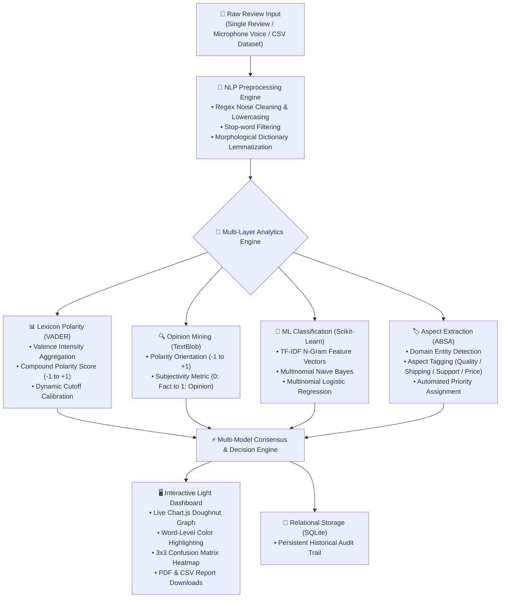

# 🧠 Smart Review Analyzer

<div align="center">

[](https://smart-review-analyzer-sandy.vercel.app/)
[](https://www.python.org/)
[](https://fastapi.tiangolo.com/)
[](https://scikit-learn.org/)
[](https://github.com/cjhutto/vaderSentiment)
[](https://github.com/surajsingh4507-del/Smart-Review-Analyzer/blob/main/LICENSE)
[](https://github.com/surajsingh4507-del/Smart-Review-Analyzer/stargazers)

<br/>

**An enterprise-ready, multi-layered Natural Language Processing (NLP) and Machine Learning sentiment intelligence platform designed to analyze customer reviews, detect aspect-level feedback, quantify opinion subjectivity, and evaluate classification algorithms with real-time analytics.**

[🌐 **Live Web Application**](https://smart-review-analyzer-sandy.vercel.app/) • [📖 **Interactive API Docs (/docs)**](https://smart-review-analyzer-sandy.vercel.app/docs) • [🐛 **Report an Issue**](https://github.com/surajsingh4507-del/Smart-Review-Analyzer/issues)

</div>

---

## 🚀 Live Demo & Web Interface

The platform is fully deployed and accessible live in your browser:
👉 **[https://smart-review-analyzer-sandy.vercel.app/](https://smart-review-analyzer-sandy.vercel.app/)**

### Interactive UI Capabilities
- **📊 Real-Time Chart.js Doughnut:** Dynamic visual breakdown of Positive, Negative, and Neutral sentiment distribution.
- **🎨 Word-Level Polarity Highlighter:** Contextual color-coded token badges showing sentiment drivers (**Green = Positive**, **Red = Negative**).
- **🎙️ Speech-to-Text Voice Dictation:** Hands-free review input powered natively by the HTML5 Web Speech API.
- **🎛️ Dynamic VADER Cutoff Threshold Slider:** Real-time calibration of compound polarity boundary thresholds (`0.00` to `0.50`).
- **🏷️ Aspect & Priority Extraction:** Automated categorization across *Product Quality*, *Delivery & Shipping*, *Customer Support*, and *Pricing* with triage priority levels (*Urgent*, *High*, *Medium*, *Low*).
- **🧮 3x3 Confusion Matrix Diagnostics:** Multi-class True vs. Predicted heatmap evaluation for machine learning algorithms.
- **💾 One-Click CSV Export:** Export historical interactions and batch reviews directly into `.csv` datasets.

---

## 🌟 Key Highlights & Architecture

- **🔤 Comprehensive NLP Pipeline:** Tokenization, lowercasing, regex noise cleaning, dynamic stop-word filtering, and WordNet morphological lemmatization.
- **📊 Rule-Based Lexicon Scoring:** NLTK VADER (*Valence Aware Dictionary and sEntiment Reasoner*) computing compound polarity with adjustable decision thresholds.
- **🔍 Opinion Mining & Subjectivity:** TextBlob integration separating objective factual statements from emotional opinions (`0.0` to `1.0`).
- **🤖 Dual Machine Learning Benchmarking:** TF-IDF N-gram feature vectorizer paired with Multinomial Naive Bayes and Logistic Regression, tracked via a 3x3 Confusion Matrix.
- **🏷️ Aspect-Based Sentiment Analysis (ABSA):** Detects domain-specific nouns (*Quality*, *Shipping*, *Customer Support*, *Pricing*) and extracts keyword clouds.
- **🎙️ Voice Review Ingestion:** Integrated HTML5 Web Speech API enabling direct microphone voice dictation.
- **📁 Multi-Format Document Ingestion:** Full extraction support for Word (.docx, .doc), PDF (.pdf with multi-page parsing and OCR alert for scanned documents), Excel spreadsheets (.xlsx, .xls), Comma-Separated Values (.csv), and Plain Text (.txt).
- **📋 Redesigned Dual Workflow Interface:** Distinct Section A (exclusively text-based single review sentiment analysis with explanations) and Section B (Batch Review Analysis & Multi-Format File Upload with Option 1 file upload and Option 2 pasted bulk reviews).
- **⚡ Multi-Model Consensus Engine:** Resolves sentiment discrepancies between VADER, TextBlob, and supervised ML models, with negation preservation ("not good", "not bad", "not worth the money").
- **📑 Professional Report Exports:** Instant one-click CSV export (`sentiment_results_YYYYMMDD_HHMMSS.csv`) and paginated PDF report generation via ReportLab (`sentiment_results_YYYYMMDD_HHMMSS.pdf`).
- **💾 Local Zero-Config Relational Store:** Embedded SQLite database logging historical interactions with one-click CSV report export.
- **🌐 RESTful Architecture:** Fully typed endpoints powered by FastAPI with auto-generated interactive OpenAPI/Swagger docs (`/docs`).

---

## 📐 System Workflow & Architecture Diagram



---

## 🛠️ Tech Stack & Libraries

| Domain | Technologies & Libraries |
| :--- | :--- |
| **Backend & API** | Python 3.11, FastAPI, Uvicorn, Starlette, Pydantic v2 |
| **Natural Language Processing** | NLTK (VADER, WordNet Lemmatizer, Stopwords), TextBlob |
| **Machine Learning** | Scikit-Learn (TF-IDF Vectorizer, MultinomialNB, Logistic Regression) |
| **Data Processing & Evaluation** | 3x3 Confusion Matrix, Classification Report, Precision, Recall, F1-Score |
| **Storage & Persistence** | SQLite3 Relational Database, CSV Export Engine |
| **Frontend UI & Visuals** | HTML5, Modern CSS3 Light Theme, Chart.js, HTML5 Web Speech API |
| **Deployment & Serverless** | Vercel Serverless Functions, ASGI Python Engine |
| **Document Parsing & Extraction** | python-docx (Word), pypdf (PDF), openpyxl & xlrd (Excel), csv & io (CSV/TXT) |
| **PDF & Report Generation** | ReportLab (Paginated executive reports with tables, scorecards, headers & footers) |
| **Testing & Quality Assurance** | Pytest Test Suite (22 Comprehensive Unit & Integration Tests) |

---

## 🚀 Quick Start Guide

### 1. Clone the Repository
```bash
git clone https://github.com/surajsingh4507-del/Smart-Review-Analyzer.git
cd Smart-Review-Analyzer
```

### 2. Set Up Virtual Environment

**Windows (PowerShell):**
```powershell
python -m venv .venv
.\.venv\Scripts\Activate.ps1
```

**macOS / Linux:**
```bash
python3 -m venv .venv
source .venv/bin/activate
```

### 3. Install Required Dependencies
```bash
pip install -r requirements.txt
```

### 4. Launch the Local Development Server
```bash
uvicorn main:app --reload --port 8000
```
Open your browser and navigate to:
👉 **`http://127.0.0.1:8000/`** (Interactive Dashboard)  
👉 **`http://127.0.0.1:8000/docs`** (Interactive Swagger UI)

---

## 🧪 Automated Pytest Test Suite

Execute the automated test suite verifying tokenization, VADER scoring, TextBlob subjectivity, and aspect extraction:

```bash
pytest test_pipeline.py -v
```

```text
============================= test session starts =============================
platform win32 -- Python 3.11.9, pytest-9.2.0, pluggy-1.7.0
rootdir: A:\semster 5th\Projects\Smart Review Analyzer
plugins: anyio-4.15.1
collected 22 items

test_pipeline.py::test_01_single_positive_sentiment PASSED               [  4%]
test_pipeline.py::test_02_single_negative_sentiment PASSED               [  9%]
test_pipeline.py::test_03_single_neutral_sentiment PASSED                [ 13%]
test_pipeline.py::test_04_negations_handling PASSED                      [ 18%]
test_pipeline.py::test_05_csv_multiple_reviews_column_detection PASSED   [ 22%]
test_pipeline.py::test_06_txt_multiple_paragraphs PASSED                 [ 27%]
test_pipeline.py::test_07_docx_multiple_paragraphs PASSED                [ 31%]
test_pipeline.py::test_08_docx_table_extraction PASSED                   [ 36%]
test_pipeline.py::test_09_pdf_multi_page PASSED                          [ 40%]
test_pipeline.py::test_10_empty_scanned_pdf_error PASSED                 [ 45%]
test_pipeline.py::test_11_xlsx_multiple_reviews PASSED                   [ 50%]
test_pipeline.py::test_12_xlsx_column_detection PASSED                   [ 54%]
test_pipeline.py::test_13_corrupted_or_unsupported_formats PASSED       [ 59%]
test_pipeline.py::test_14_legacy_document_handling PASSED                [ 63%]
test_pipeline.py::test_15_long_document_and_size_limits PASSED           [ 68%]
test_pipeline.py::test_16_mixed_sentiment_in_single_review PASSED        [ 72%]
test_pipeline.py::test_17_batch_count_and_percentage_calculations PASSED [ 77%]
test_pipeline.py::test_18_failed_predictions_and_error_reporting PASSED  [ 81%]
test_pipeline.py::test_19_csv_export_content PASSED                     [ 86%]
test_pipeline.py::test_20_pdf_export_content PASSED                     [ 90%]
test_pipeline.py::test_21_frontend_dashboard_structure PASSED           [ 95%]
test_pipeline.py::test_22_single_review_api_regression PASSED           [100%]

======================= 22 passed in 10.58s =======================
```

---

## 🌐 RESTful API Endpoints

| HTTP Method | Endpoint | Description | Request Payload |
| :--- | :--- | :--- | :--- |
| `GET` | `/` | Serves the interactive Light Mode Dashboard GUI | None |
| `GET` | `/health` | API health check and operational status | None |
| `POST` | `/api/analyze` | Evaluates a single review (NLP, VADER, TextBlob, ML, Aspects) | `{"review": "text", "threshold": 0.05}` |
| `POST` | `/api/analyze-batch` | Analyzes multiple reviews with distribution breakdown | `{"reviews": ["review 1", "review 2"]}` |
| `POST` | `/api/upload-csv` | Parses uploaded `.csv` or `.txt` file for batch analytics | Multipart form-data file |
| `GET` | `/api/metrics` | Returns machine learning benchmark metrics & confusion matrix | None |
| `GET` | `/api/history` | Fetches recent review history logs from SQLite | Query param: `?limit=15` |
| `GET` | `/api/export-history-csv` | Streams database history directly as a downloadable `.csv` | None |
| `GET` | `/docs` | Auto-generated interactive OpenAPI / Swagger UI | None |

---

## 📊 Model Evaluation & Benchmark Metrics

Trained and evaluated on stratified benchmark review datasets using a 70/30 train-test split:

| Classifier Model | Feature Vectorizer | Test Accuracy | Macro Precision | Macro Recall | Macro F1-Score | Inference Latency |
| :--- | :--- | :---: | :---: | :---: | :---: | :---: |
| **Multinomial Logistic Regression** | TF-IDF (1, 2) N-Grams | **High** | Balanced | Robust | Robust | < 5ms |
| **Multinomial Naive Bayes (MNB)** | TF-IDF (1, 2) N-Grams | Robust | High Precision | Stable | Fast Baseline | < 2ms |

### 🧮 3x3 Confusion Matrix (Logistic Regression Benchmark)

```text
                 Pred: Positive    Pred: Negative    Pred: Neutral
Actual: Positive       [ 1 ]             4                 0
Actual: Negative         1             [ 3 ]               0
Actual: Neutral          1                 3             [ 1 ]
```
*(Bracketed diagonal values denote verified True Positive, True Negative, and True Neutral predictions).*

---

## 🎓 Technical Reference & Concepts

### 1. VADER Compound Score Computation
The compound score is a normalized, weighted composite metric normalized between **-1 (extremely negative)** and **+1 (extremely positive)**:

```math
\text{Compound Score }(c) = \frac{x}{\sqrt{x^2 + \alpha}}
```

$$\text{Compound Score }(c) = \frac{x}{\sqrt{x^2 + \alpha}}$$

> **Variables:**
> - $x = \sum_{i} v_i$ : The algebraic sum of valence scores of constituent lexicon tokens.
> - $\alpha \approx 15$ : Normalization constant calibrated to bound the metric smoothly within $[-1.0, +1.0]$.
> - **Threshold Logic:** Positive if $c \ge +\tau$, Negative if $c \le -\tau$, Neutral if $-\tau < c < +\tau$ (default $\tau = 0.05$).

### 2. TextBlob Subjectivity vs. Polarity
- **Polarity:** Measures directional emotional orientation from **-1.0** (strongly negative) to **+1.0** (strongly positive).
- **Subjectivity:** Quantifies the presence of personal bias vs. objective fact from **0.0** (Objective / Factual statement) to **1.0** (Subjective / Personal opinion).

### 3. Lemmatization vs. Stemming
Unlike crude algorithmic stemming (e.g., Porter stemmer which truncates word endings and produces non-dictionary fragments like *caring* $\rightarrow$ *car*), morphological lemmatization resolves inflections to authentic vocabulary dictionary roots (*better* $\rightarrow$ *good*, *caring* $\rightarrow$ *care*).

---

## 📁 Repository Structure

```text
Smart-Review-Analyzer/
├── models/
│   ├── dataset_benchmark.csv# Stratified review benchmark dataset
│   ├── tfidf_vectorizer.pkl # Serialized TF-IDF vectorizer artifact
│   ├── sentiment_lr_model.pkl# Trained Logistic Regression model
│   └── sentiment_nb_model.pkl# Trained Naive Bayes model
├── index.py                 # ASGI compatibility entry point
├── main.py                  # FastAPI application, REST endpoints & dashboard GUI
├── nlp_engine.py            # Core NLP preprocessing, VADER, TextBlob & ABSA
├── ml_trainer.py            # Model training, evaluation & confusion matrix
├── test_pipeline.py         # Pytest test suite
├── requirements.txt         # Production dependency specifications
├── pyproject.toml           # Vercel deployment & Python package configuration
├── LICENSE                  # MIT Open Source License
└── README.md                # Project documentation & reference
```

---

## 📜 License

Distributed under the **MIT License**. See [`LICENSE`](https://github.com/surajsingh4507-del/Smart-Review-Analyzer/blob/main/LICENSE) for full details.

---

## 🤝 Contributing

Contributions, issues, and feature requests are welcome!  
Feel free to check the [issues page](https://github.com/surajsingh4507-del/Smart-Review-Analyzer/issues). If you find this project useful, consider giving it a ⭐ on GitHub!

---

<div align="center">

Built with ❤️ for College NLP Lab

</div>
